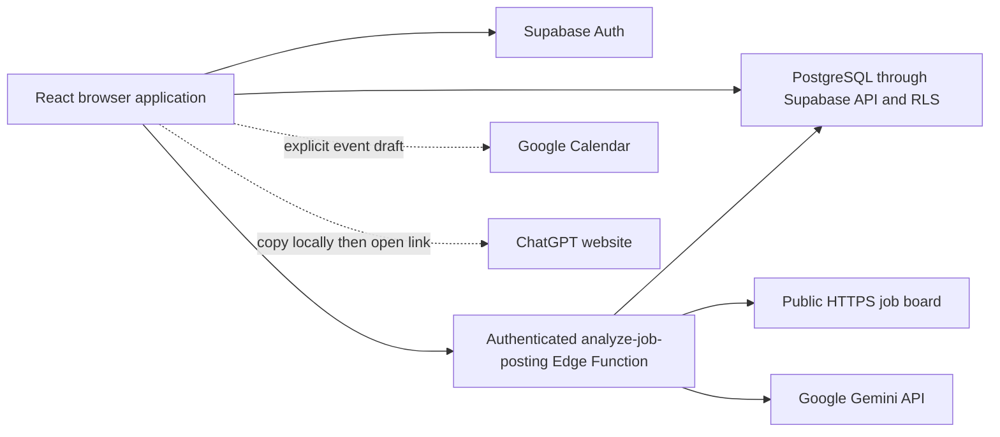
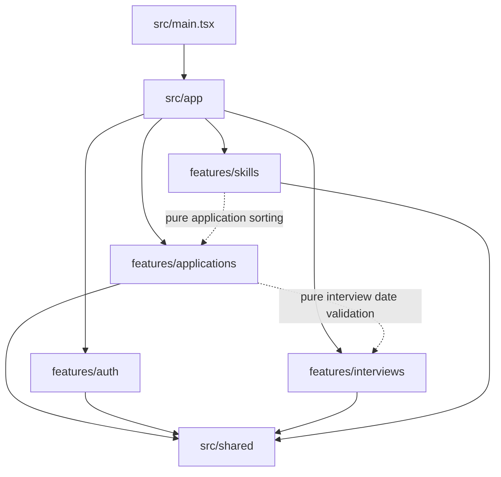

# Architecture

Rolecall uses a feature-based React structure with an application composition layer. `src/main.tsx` mounts React into root `index.html`; `src/app/App.tsx` owns authentication/session state, loaded applications, database mutations, notices, and page composition. Features receive explicit records and callbacks. There is no Redux store or React Router dependency.

The browser uses a publishable key and authenticated session. The analyzer uses the caller's Authorization header with a public database key, retaining RLS. Gemini credentials stay in function secrets. Calendar and ChatGPT are user-initiated link/clipboard flows, not authenticated API connections.

## Directory responsibilities

| Path | Responsibility |
| --- | --- |
| `src/app/` | State/persistence composition and hash routing |
| `src/features/applications/` | Forms/details/status, sorting, row conversion, legacy import |
| `src/features/auth/` | Sign-in and missing-configuration UI |
| `src/features/interviews/` | Scheduling, agenda/type filters, dates and Calendar drafts |
| `src/features/skills/` | Skills/company practice, priorities, question selection and prompt preparation |
| `src/shared/` | Shared types, Supabase browser client, reusable UI/utilities |
| `src/styles/` | Global/component styles imported through the existing entries |
| `src/test/{unit,components,integration}/` | Pure helpers, isolated UI, and orchestration tests |
| `supabase/migrations/` | Ordered schema, grants, RLS, and analysis-version changes |
| `supabase/functions/analyze-job-posting/` | Deno bootstrap, injectable handler, extraction/questions/cache logic |
| `supabase/tests/` | Real PostgreSQL ownership/grant checks |
| `docs/` | Contributor decisions, coverage, research, screenshots, and wiki source |

Compose cross-feature UI through App callbacks. Shared code must not import app/features. Deliberate pure-helper exceptions are legacy application validation and application sorting importing interview date validation, and Skills consuming application sorting. These are domain-data dependencies, not UI cycles. Prefer explicit imports; no barrel/alias framework is imposed.

## Routing and asynchronous ownership

`routing.ts` parses hash routes and `useAppRoute.ts` synchronizes browser navigation:

| Hash | Screen |
| --- | --- |
| `#/applications` | Applications (also the fallback for unknown routes) |
| `#/interviews` | Upcoming interviews |
| `#/skills` | Overall Skills library |
| `#/skills/application/<encoded-id>` | One application's Skills |
| `#/skills/company/<encoded-company>` | Company interview practice |

Hashes need no server-side route rewrite. IDs/names are decoded defensively; they do not grant database access. App clears account state on session changes and guards asynchronous loads/mutations with account identity and an epoch, including sign-out/sign-in to the same account. Per-application knowledge-save locks prevent overlapping writes across Skills/company screens. Pending/error UI lets users retry without claiming failed changes were saved.

[Architecture decision and file mapping](https://github.com/Coreyboy1820/job-application-tracker/blob/main/docs/architecture.md) · [App source](https://github.com/Coreyboy1820/job-application-tracker/blob/main/src/app/App.tsx) · [Data model](Data-model-and-flows.md)
