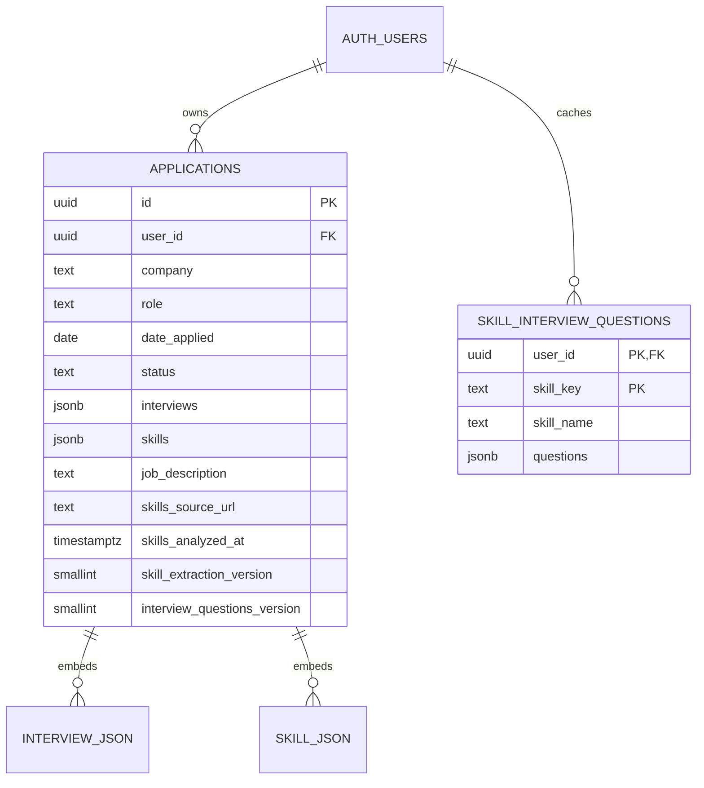
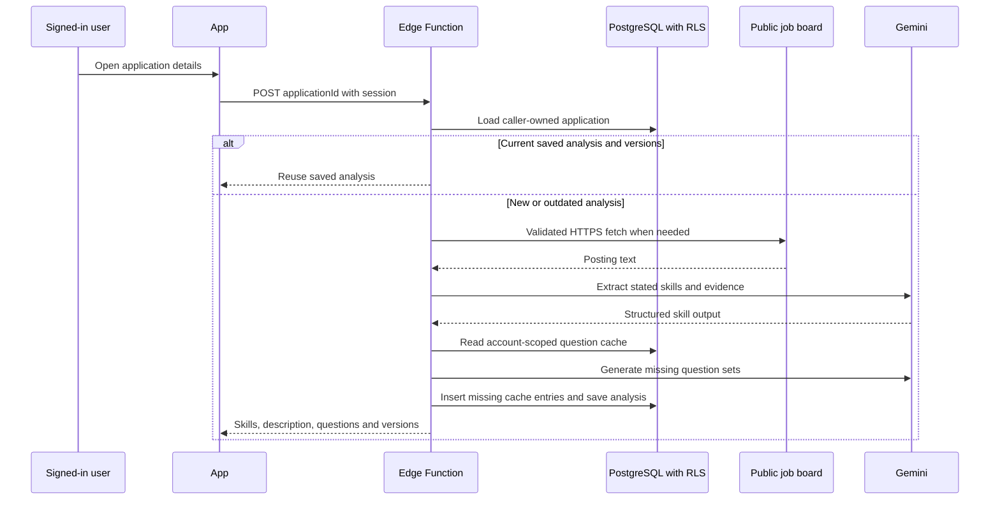
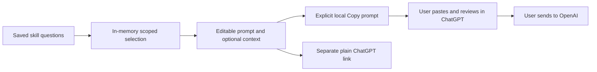

# Data model and flows

## Persisted records

`INTERVIEW_JSON` and `SKILL_JSON` above are embedded objects, **not separate SQL tables**. An application also stores location, URL, notes, next step, and creation time. Interviews contain id, local date/time, notes, optional type/location/meeting link/duration, and optional Calendar-opened timestamp. Skills contain name, category, importance (required/preferred/mentioned), evidence, optional questions, knowledge rating, and compatibility/priority fields.

Database fields use snake_case while browser models use camelCase: `date_applied` → `dateApplied`, `next_step` → `nextStep`, `job_description` → `jobDescription`, and analysis timestamps/source/version fields are converted similarly. `applicationRow.ts` supplies mappings/default arrays; shared types define frontend contracts. `user_id` is used for ownership in database operations rather than exposed as part of the Application model.

Applications allow authenticated select/insert/update/delete only for `auth.uid() = user_id`; update checks prevent moving a row to another owner. The question cache allows authenticated owned select/insert, with `(user_id, skill_key)` as its primary key and exactly three bounded strings. Both deny anonymous table access. Auth user deletion cascades to owned rows. Browser filtering and async guards complement RLS; they do not replace it.

## Job analysis and question caching

The saved source URL and version fields determine reuse/refresh. Outdated extraction can use the saved description and preserves compatible knowledge settings; changing the posting URL invalidates analysis. Skill groups/examples are normalized to individual skills and duplicates removed. Question keys normalize skill names, letting another application in the same account reuse the same three general questions. Other users' cache entries are inaccessible.

The analyzer requires a valid application UUID and caller authorization. Public HTTPS-only checks validate hosts/DNS and each redirect, limit page downloads to 2 MB, and reject private destinations. Job boards requiring login or browser JavaScript may fail. Text, company, and role are sent to Gemini for extraction; general question generation uses skill names without company/role/candidate context.

## Legacy import

Read legacy local-storage/IndexedDB records, normalize compatible fields, present import after sign-in, and write account-owned rows. Avoid duplicate imported ids, preserve source records, and set the per-account import marker only after success. Invalid legacy data is not silently erased. Legacy browser records and the marker remain local; newly created application records live in Supabase. The Auth SDK can also persist its own session in browser storage.

## Interview practice

The prompt includes selected question text and skill labels; company/roles are opt-in. It excludes application notes, candidate biography, interview notes, meeting links, account/session details, database ids, and posting URLs unless the user manually adds them to the editable text. Exact duplicate questions combine labels. Batches keep complete questions. Preview/selection are not saved or logged.

## External data boundaries

| Action | Shared data and recipient | Trigger |
| --- | --- | --- |
| Analyze posting | Posting text and company/role to Gemini; public request to job board | Opening details with analysis needed |
| Calendar draft | Company, role, type, notes, location/meeting link, date/time/duration, and application/interview IDs as a Rolecall reference in Google event URL | Explicit continue after sharing notice |
| Copy practice prompt | Preview text to the device clipboard | Copy prompt |
| Open ChatGPT | Ordinary navigation to `https://chatgpt.com/`, no prompt payload | Open ChatGPT |
| ChatGPT practice | Text the user pastes/sends to OpenAI, under that account's settings | User sends inside ChatGPT |

Clipboard content may persist on the device. Calendar opened markers are warnings, not reliable synchronization/deduplication. No Google/OpenAI credentials are requested or stored by Rolecall.

[Shared models](https://github.com/Coreyboy1820/job-application-tracker/blob/main/src/shared/types.ts) · [Row mappings](https://github.com/Coreyboy1820/job-application-tracker/blob/main/src/features/applications/data/applicationRow.ts) · [Migrations](https://github.com/Coreyboy1820/job-application-tracker/tree/main/supabase/migrations)
